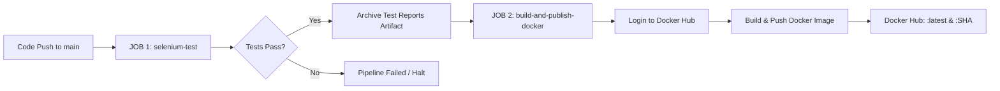

# Area of Circle JUnit Automation — Automated Testing Framework & Containerized CI/CD Pipeline


## 📌 Project Overview

**Area of Circle JUnit Automation** is an end-to-end automated testing and continuous integration/continuous deployment (CI/CD) framework. It automates functional UI regression testing for a web login application using **Selenium WebDriver** and **TestNG**, packages the framework into an isolated **multi-stage Docker container**, and deploys the container image directly to **Docker Hub** upon every successful build on the `main` branch.

---

## 🛠 Tech Stack

| Technology | Purpose |
| :--- | :--- |
| **Java 17 (Temurin)** | Primary programming language |
| **Selenium WebDriver 4.25.0** | Browser automation engine (Chrome / Headless Chromium) |
| **TestNG 7.10.2** | Test execution, assertions, annotations, and test reporting |
| **Apache Maven** | Project lifecycle management and dependency resolution |
| **Docker** | Multi-stage image build and container runtime isolation |
| **GitHub Actions** | Automated two-stage CI/CD pipeline |
| **Docker Hub** | Public cloud container image registry |

---

## 📂 Project Structure

```text
AreaOfCircle-JUnit-Automation/
│----- Dockerfile                              # Multi-stage Docker build recipe
├── pom.xml                                 # Maven dependencies and surefire configuration
├── testng.xml                              # TestNG suite runner XML configuration
├── README.md                               # Project documentation and execution guide
├── webpage/
│   └── login.html                          # Target web application for automated testing
└── src/
    └── test/
        └── java/
            └── LocalLoginTest.java         # TestNG automated test suite with explicit waits
```

---

## 🧪 Test Automation Suite

The test suite in [`LocalLoginTest.java`](src/test/java/LocalLoginTest.java) executes three core test scenarios:

1. **`validLoginTest`**:
   - Enters student username (`student`) and password (`12345`).
   - Triggers the login action and verifies the success message: `Login Successful`.
2. **`invalidLoginTest`**:
   - Enters invalid credentials (`wrong` / `wrong`).
   - Validates that the system displays the error warning: `Invalid Username or Password`.
3. **`checkBackgroundColor`**:
   - Inspects the DOM and validates the styling of the login container box matches the required lightblue brand color (`rgba(173, 216, 230, 1)`).

All test methods utilize **Selenium 4 explicit waits (`WebDriverWait` & `ExpectedConditions`)** for resilience across headless and containerized test runners.

---

## 🚀 Local Execution

### Prerequisites
- JDK 17 installed and configured in `JAVA_HOME`
- Apache Maven 3.9+
- Google Chrome browser

### Run Tests via Maven
```bash
mvn clean test
```

Test results and reports are automatically generated in `target/surefire-reports/`.

---

## 🐳 Docker Containerization

The project uses a two-stage Docker blueprint:
1. **Stage 1 (Build)**: Uses `maven:3.9.9-eclipse-temurin-17`, resolves dependencies offline, and compiles TestNG test classes.
2. **Stage 2 (Runtime)**: Installs Chromium browser, copies compiled assets, and configures the environment to execute the automated suite.

### Build the Docker Image Locally
```bash
docker build -t shreyas050906/area-of-circle-junit-automation:latest .
```

### Run the Container
```bash
docker run --rm shreyas050906/area-of-circle-junit-automation:latest
```

---

## 🔄 CI/CD Pipeline (GitHub Actions)

The repository automated workflow is defined in [`.github/workflows/selenium-tests.yml`](.github/workflows/selenium-tests.yml) and consists of two sequential jobs:



### GitHub Secrets Required
- `DOCKERHUB_USERNAME`: Docker Hub account username (`shreyas050906`)
- `DOCKERHUB_TOKEN`: Personal Access Token with Read & Write permissions

---

## 📦 Docker Hub Registry Details

- **Registry Repository**: [`shreyas050906/area-of-circle-junit-automation`](https://hub.docker.com/r/shreyas050906/area-of-circle-junit-automation)
- **Tags Published**:
  - `latest`: Tracks the most recent successful build on `main`.
  - `<commit-sha>`: Immutable snapshot tag tied to each specific Git commit.
